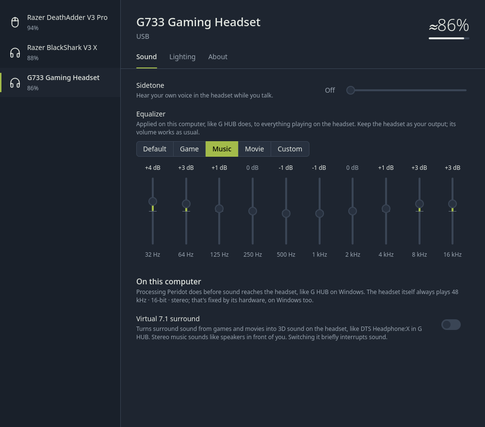
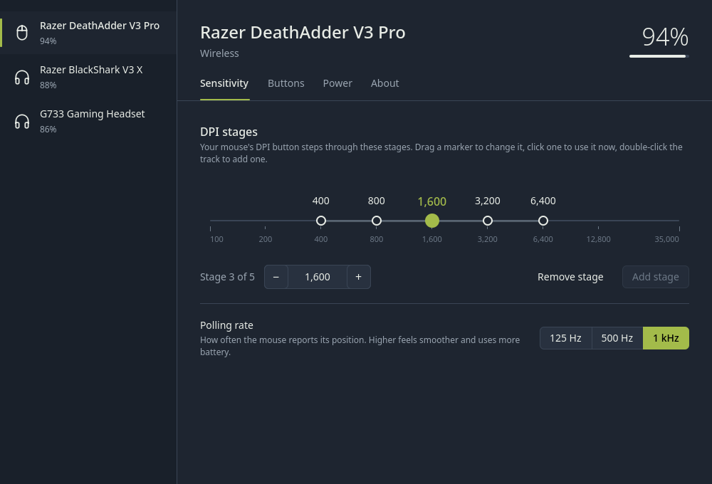
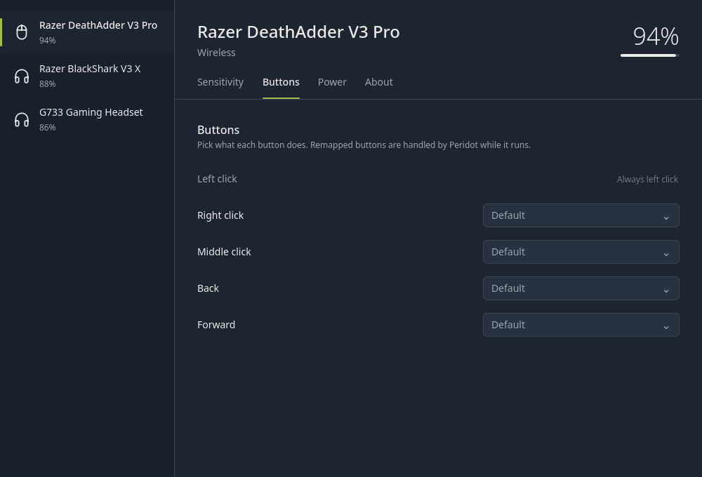
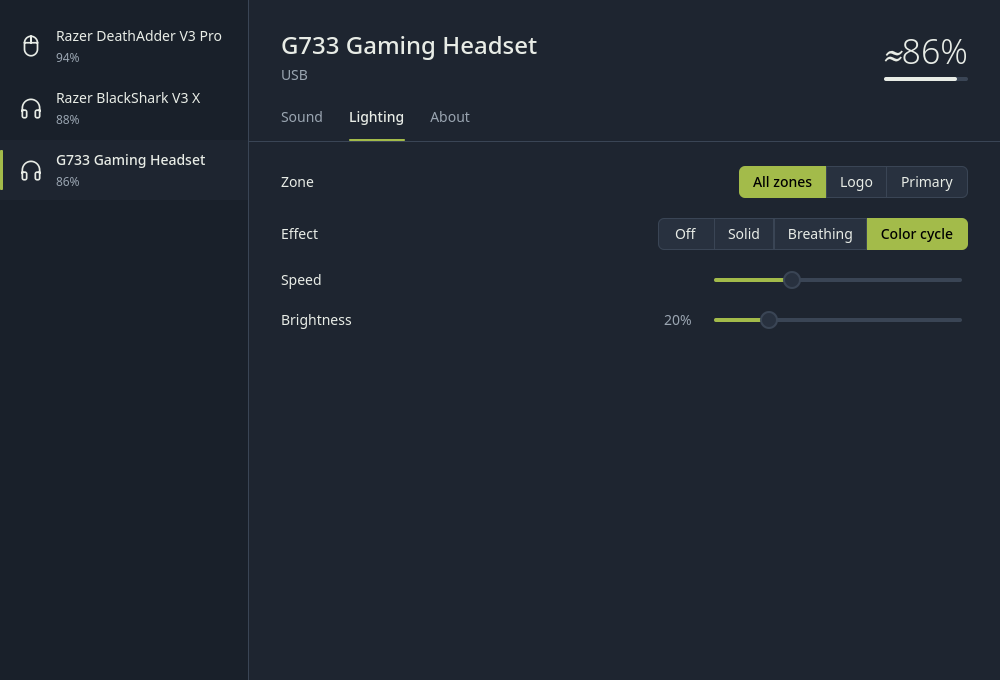
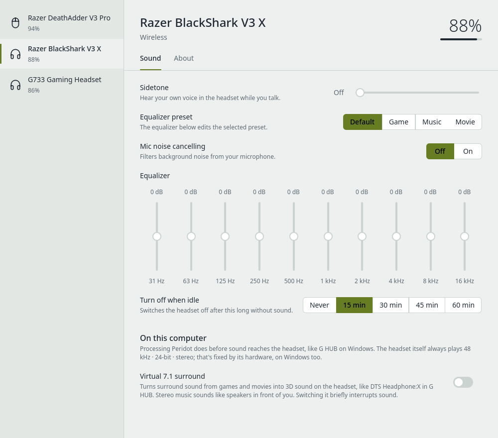

# Peridot

One app for your Logitech and Razer mice and headsets on Linux: battery in the
tray, DPI stages, polling rate, RGB lighting, button remapping, and headset
sidetone, equalizer, virtual surround and auto power-off. Built for CachyOS /
Arch with KDE Plasma, works on any systemd desktop.

It replaces juggling Solaar, OpenRazer + Polychromatic, piper/ratbagd and
HeadsetControl with a single service and a single window.



| | |
|---|---|
|  |  |
|  |  |

## What it does

| | Logitech (HID++ 2.0) | Razer |
|---|---|---|
| Battery, charging, low-battery notifications | ✓ (4 battery protocols, incl. voltage-only headsets) | ✓ wireless mice and headsets |
| DPI with stages | ✓ (stages cycled by Peridot) | ✓ (stages stored in the mouse) |
| Polling rate | ✓ up to 8 kHz on supporting mice | ✓ incl. 8 kHz HyperPolling |
| Lighting per zone, brightness | ✓ | ✓ 3 protocol generations |
| Button remapping | ✓ in hardware, any divertable button | ✓ in software (only while remapped) |
| Shortcuts, media keys, DPI up/down, sniper hold | ✓ | ✓ |
| Headset sidetone, equalizer, auto power-off | ✓ G633 / G733 / G933 / G935 / G PRO X class | ✓ see the list below |
| Virtual 7.1 surround on headsets | ✓ | ✓ |
| Sleep timer, low-battery threshold | – | ✓ |
| Receivers (Unifying, Lightspeed, Bolt), Bluetooth | ✓ incl. sleeping devices | ✓ HyperSpeed dongles |

Things that make day-to-day use nicer than the existing tools:

- **Settings stick.** Many mice forget host settings when they sleep or
  reconnect. Peridot saves every change per device and re-applies it whenever
  the device wakes, replugs or the session starts. Change something while a
  mouse is asleep and it's applied when it wakes.
- **On-board profiles are handled.** Logitech gaming mice ignore DPI changes in
  on-board mode; Peridot switches them to host mode when you change DPI or
  polling rate and tells you it did.
- **One clear UI.** Only the sections a device supports are shown; no protocol
  names, no dead toggles.
- **Fast and small.** The daemon is about 12,000 lines of dependency-free Rust
  (no crates, builds offline), talks to hidraw directly, and needs no kernel
  module.

### Headset sound

- **Equalizer with presets.** Default, Game, Music and Movie, plus *Custom*:
  whatever you tune by hand is kept, so you can try a preset and go back to
  your own curve. Razer headsets with presets of their own use those instead.
- **EQ for headsets that won't take one.** Some headsets, the G733 among
  them, list an equalizer but their firmware refuses changes from the
  computer. G HUB applies the EQ on the PC for these, and so does Peridot: a
  PipeWire filter that WirePlumber puts in front of the headset. You keep
  picking the headset as your output, its own volume control keeps working,
  and everything that plays on it goes through the EQ.
- **Virtual 7.1 surround**, like G HUB's DTS Headphone:X: surround from games
  and films becomes 3D sound on the headset, using the MIT KEMAR HRTF that
  ships with libmysofa. Levels are matched to plain stereo.

Like in G HUB, sound processing on the computer only applies to sound from
this computer. The app also shows the headset's audio format (the G733 plays
48 kHz, 16-bit stereo); that's fixed by the hardware, on Windows too.

### Razer headsets

| Headset | USB id | Battery | Sidetone | Equalizer | Auto power-off | Other |
|---|---|---|---|---|---|---|
| BlackShark V3 (dongle / cable) | 057a / 0579 | ✓ | ✓ | ✓ (saved in the Game preset) | ✓ | |
| BlackShark V3 Pro (dongle / cable) | 0577 / 0576 | ✓ | ✓ | ✓ (custom slot) | ✓ | noise cancelling / ambient |
| BlackShark V3 Pro for Xbox (dongle) | 0a55 | ✓ | ✓ | ✓ | ✓ | noise cancelling / ambient |
| BlackShark V3 X HyperSpeed (dongle / cable) | 057d / 057c | ✓ | ✓ | ✓ (per preset) | ✓ | EQ preset, mic noise cancelling |
| BlackShark V2 Pro (2023) | 0555 | ✓ | ✓ | ✓ | ✓ | |
| BlackShark V2 HyperSpeed (dongle / cable) | 0565 / 0566, 056e | ✓ | ✓ | ✓ | ✓ | |
| Kraken V4 (dongle) | 056c | ✓ | | | | |
| Barracuda (2.4 GHz dongle) | 0584, 053c | ✓ | ✓ | | ✓ | |
| Barracuda X (dongle) | 0552 | ✓ | | | | |

The BlackShark V3 family only accepts settings when Linux reads its USB
configuration the way Windows does. Linux 7.3 has a switch for that; Peridot's
udev rule turns it on for these headsets and re-plugs them once in software.
If the app says the headset isn't answering, unplug its dongle or cable and
plug it back in. On older kernels, see `third_party/razer-cfg255`.

## Install (CachyOS / Arch)

```sh
git clone https://github.com/LousySniper/peridot.git
cd peridot
./install.sh
```

The script installs what it needs (it works with `rustup` or the `rust`
package), builds, sets up device permissions, stops Solaar or OpenRazer if
they're running, starts the service and opens the app. To upgrade, `git pull`
and run it again; `./uninstall.sh` removes everything except your saved
settings (`~/.config/peridot`).

Other distros: install `cargo`, `cmake`, `ninja` and Qt 6.6+ (base,
declarative, svg), then `make PREFIX=/usr && sudo make PREFIX=/usr install`,
reload udev rules and run `systemctl --user enable --now peridotd`. Headset
sound processing needs PipeWire with WirePlumber 0.5+, and libmysofa for
surround.

## Command line

```sh
peridotctl list
peridotctl show "pro x"
peridotctl dpi "pro x" 1600
peridotctl stages deathadder 400,800,1600,3200 3
peridotctl rate "pro x" 1000
peridotctl light basilisk spectrum
peridotctl light basilisk static '#00ffaa' --zone logo
peridotctl button "pro x" 0053 key:ctrl+shift+t
peridotctl sidetone g733 40
peridotctl eq g733 4,3,1,0,-1,-1,0,1,3,3
peridotctl set g733 surround true
peridotctl brightness g733 40
peridotctl mode "v3 pro" anc ambient
peridotctl monitor
```

Devices match by id or any part of the name. The full API is in
[docs/dbus-api.md](docs/dbus-api.md).

## How it works

```
peridot (Qt 6 / QML, tray)  ──D-Bus──  peridotd (Rust, user service)
peridotctl (CLI)            ──D-Bus──┘    ├─ HID++ 1.0/2.0 driver ── /dev/hidraw* (Logitech)
                                          ├─ Razer driver ────────── /dev/hidraw* feature reports
                                          ├─ settings store ──────── ~/.config/peridot/devices/*.json
                                          ├─ actions ─────────────── /dev/uinput, evdev grabs
                                          └─ headset sound ───────── PipeWire filter-chain, WirePlumber smart filter
```

- `daemon/src/hidpp/`: channel with request/notification separation, feature
  discovery, receivers (pairing, sleep/wake), and every feature listed above.
- `daemon/src/razer/`: the 90-byte report protocol and a per-product table
  (117 mice: transaction ids, interfaces, timings, zones) generated from the
  OpenRazer sources by `tools/gen_razer_table.py`.
- `daemon/src/razer/blackshark.rs`: the Razer headsets' vendor protocol (two framings).
- `daemon/src/softeq.rs`: the headset sound filter (EQ, virtual surround).
- `daemon/src/sim.rs`: byte-level device simulators used by the tests.
- Access is granted through udev `uaccess` (only the active local user), the
  same model Solaar uses. No root daemon.

## Development

```sh
make                        # daemon and app
cd daemon && cargo test     # unit + end-to-end protocol tests against simulators
PERIDOT_LOG=trace peridotd  # hex dump of every report
```

Screenshots in `docs/screenshots` are rendered by the app itself:

```sh
QT_QPA_PLATFORM=offscreen peridot --device g733 --section sound --window-size 1000x880 --screenshot sound.png
```

Regenerating the Razer table after an OpenRazer update:

```sh
python3 tools/extract_razer.py /path/to/openrazer razer.json
python3 tools/gen_razer_table.py razer.json /path/to/openrazer/daemon/openrazer_daemon/hardware/mouse.py daemon/src/razer/devices.rs
```

## Status and limits

- Protocol details come from Solaar, libratbag, OpenRazer, HeadsetControl and
  the Razer headset reverse-engineering projects (blackshark-control,
  razer-blackshark-v2-hyperspeed-webhid, OpenRazer PR #2794, HeadsetControl
  PR #587, openbarracuda, razer-barracuda-2.4-linux, razer-barracuda,
  razer-blackshark-v3-quirk, OpenRazer PR #2899 for the V3 X). Expect quirks
  on specific models; please [open an issue](https://github.com/LousySniper/peridot/issues)
  with the output of `PERIDOT_LOG=trace peridotd`.
- Devices Peridot recognises as Razer/Logitech but can't drive yet are listed
  by `peridotctl status`, with the command whose output helps add them.
- Not supported yet: other Razer headsets (older Krakens, BlackShark V2 / V2 X
  wired, the 2020 V2 Pro), Logitech's newer "Centurion" headsets (PRO X 2
  LIGHTSPEED, G522), keyboards' per-key lighting, editing on-board profiles,
  and macros.
- The Logitech G733 presets are Peridot's own curves; Logitech doesn't publish
  G HUB's.
- Shortcuts and media keys on mouse buttons need the uinput module; the app
  says when it's missing (usually: reboot after a kernel update).

## License

[GPL-3.0-or-later](LICENSE). Device facts and protocol knowledge come from the
GPL-licensed Solaar, libratbag, OpenRazer and HeadsetControl projects.
