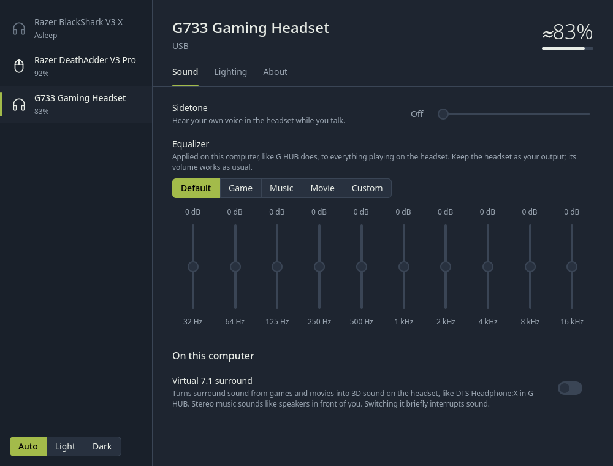

# Peridot

One app for your Logitech and Razer mice, keyboards and headsets on Linux:
battery in the tray, DPI, polling rate, lighting, button remapping, and headset
sidetone, equalizer and virtual surround. It replaces Solaar, OpenRazer,
Piper and HeadsetControl with one service and one window.



## Supported devices

- **Logitech:** mice and keyboards (HID++, including Unifying, Lightspeed and
  Bolt receivers and Bluetooth), older Unifying devices (battery), and the
  G633, G733, G933, G935, G PRO X, G PRO X 2 LIGHTSPEED and G522 headsets.
- **Razer:** 117 mice, 122 keyboards, 28 mouse mats, docks and stands, and the
  BlackShark V2 / V3, Barracuda and Kraken headsets.

Headsets get an equalizer with presets, and virtual 7.1 surround through
PipeWire. Settings are saved and re-applied whenever a device wakes up or
reconnects.

## Install (CachyOS / Arch)

```sh
git clone https://github.com/LousySniper/peridot.git
cd peridot
./install.sh
```

The script installs what it needs, builds, sets up device permissions and
starts the service and the app. Run it again after `git pull` to upgrade;
`./uninstall.sh` removes everything except your saved settings.

Other distros: install `cargo`, `cmake`, `ninja` and Qt 6.6+ (base,
declarative, svg), then `make PREFIX=/usr && sudo make PREFIX=/usr install` and
`systemctl --user enable --now peridotd`.

## Command line

```sh
peridotctl list
peridotctl dpi deathadder 1600
peridotctl eq g733 4,3,1,0,-1,-1,0,1,3,3
peridotctl light basilisk static '#00ffaa'
```

Devices match by id or any part of the name; `peridotctl help` lists the rest.

## Notes

- Tested on a Razer DeathAdder V3 Pro, Razer BlackShark V3 X and Logitech G733.
  Other devices follow Solaar, OpenRazer and HeadsetControl; if one
  misbehaves, please [open an issue](https://github.com/LousySniper/peridot/issues).
- Razer BlackShark V3 headsets need Linux 7.3 or newer; if the app says the
  headset isn't answering, unplug and replug its dongle once.

## Reporting a problem

Run `PERIDOT_LOG=trace peridotd` (after `systemctl --user stop peridotd`),
reproduce it, and attach the output to an issue.

## License

[GPL-3.0-or-later](LICENSE). Device knowledge comes from Solaar, libratbag,
OpenRazer and HeadsetControl.
